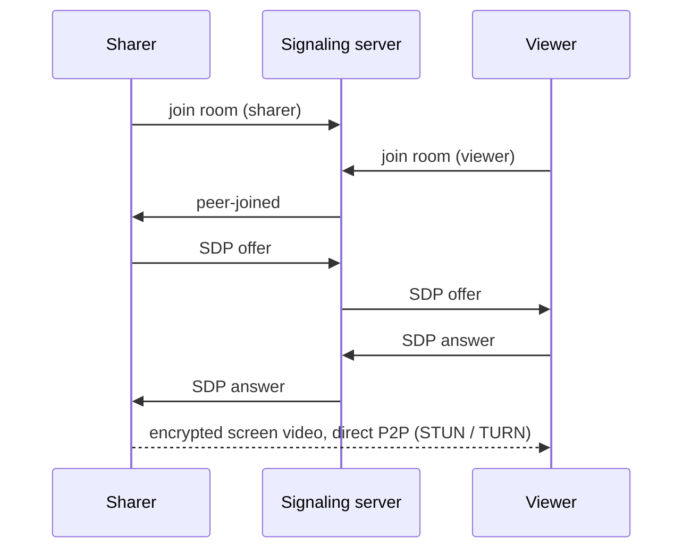

# p2pshare

[](https://github.com/0xgitpushpray/P2P-screen-sharing/actions/workflows/ci.yml)

[](LICENSE)

Lightweight peer-to-peer screen sharing from the terminal. Share your screen with
anyone over the internet using one command; viewers watch it in a native window.
No browser, no account, and no video passes through a server.

```console
$ p2pshare share
Sharing monitor 1 in room 'k3v9x0q2mz'. Viewers can join with:

    p2pshare view k3v9x0q2mz --server wss://signal.example.com
```

## Features

- **Direct and encrypted.** Video travels peer to peer over WebRTC (DTLS-SRTP). The server only introduces the two sides.
- **Works across the internet.** STUN handles NAT traversal, with optional TURN for strict networks.
- **One sharer, many viewers.** The screen is captured once and sent to every viewer.
- **Adaptive.** The bitrate follows each viewer's bandwidth. Frame rate, resolution, and bitrate ceiling are all configurable.
- **Small.** About 650 lines of Python built on [aiortc](https://github.com/aiortc/aiortc), [websockets](https://github.com/python-websockets/websockets), [mss](https://github.com/BoboTiG/python-mss), and [OpenCV](https://opencv.org/).
- **Easy to self-host.** The signaling server needs only `websockets` and ships with a Dockerfile.

## How it works



The signaling messages are a few kilobytes of JSON over a WebSocket. After the
handshake the server is no longer involved; it only reappears when someone joins
or leaves.

## Installation

Requires Python 3.10 or newer on Windows, macOS, or Linux (X11).

```bash
pipx install git+https://github.com/0xgitpushpray/P2P-screen-sharing.git
# or
pip install git+https://github.com/0xgitpushpray/P2P-screen-sharing.git
```

## Usage

### Try it on one machine

Run each command in its own terminal:

```bash
p2pshare server
p2pshare share --room demo
p2pshare view demo
```

### Share with someone over the internet

1. **Run the signaling server somewhere public** (see [Deploying the signaling server](#deploying-the-signaling-server)).
2. **Share:**

   ```bash
   p2pshare share --server wss://signal.example.com --password hunter2
   ```

3. **Send the printed `p2pshare view ...` command to your viewers.** In the viewer window, press **f** for fullscreen and **q** or **Esc** to quit.

Set `P2PSHARE_SERVER` (and `P2PSHARE_PASSWORD`) so you don't have to type `--server` and `--password` every time.

### Options

| Command | Option | Default | Description |
|---|---|---|---|
| `share` | `--room` | random | Room name. The random default works like a shared secret. |
| | `--monitor` | `1` | Monitor index; `0` captures all monitors. |
| | `--list-monitors` | | List monitors and exit. |
| | `--fps` | `15` | Capture frame rate. |
| | `--max-width` | `1920` | Downscale wider screens, keeping the aspect ratio. |
| | `--max-bitrate` | `1500` | Encoder ceiling in kbps. Raise it (for example `4000`) for sharper text. |
| `share`, `view` | `--server` | `$P2PSHARE_SERVER` or `ws://localhost:8765` | Signaling server URL. |
| | `--password` | `$P2PSHARE_PASSWORD` | Room password. |
| | `--stun` | Google public STUN | STUN server URL. |
| | `--turn`, `--turn-user`, `--turn-password` | `$P2PSHARE_TURN*` | TURN relay, for example `turn:turn.example.com:3478`. |
| `server` | `--host`, `--port` | `0.0.0.0`, `$PORT` or `8765` | Listen address. |
| | `--max-viewers` | `16` | Viewers allowed per room. |
| | `--certfile`, `--keyfile` | | Serve `wss://` directly. |

Add `-v` before the command (`p2pshare -v share`) for debug logs.

## Deploying the signaling server

The server carries no video, so the smallest VPS or a free PaaS tier is enough.

- **Docker:**

  ```bash
  docker build -t p2pshare-signal .
  docker run -p 8765:8765 p2pshare-signal
  ```

- **PaaS** (Render, Railway, Fly.io, ...): run `python -m p2pshare server`. It reads `$PORT` and answers `GET /healthz`.
- **TLS:** in production, use `wss://`. Either put the server behind a TLS-terminating proxy (Caddy, nginx, or your platform's) or pass `--certfile` and `--keyfile`.

### Strict NATs and firewalls

Most home and office networks connect directly using STUN. Symmetric NATs, some
mobile carriers, and locked-down corporate networks need a TURN relay, such as
a self-hosted [coturn](https://github.com/coturn/coturn) or a hosted TURN service:

```bash
p2pshare share --turn turn:turn.example.com:3478 --turn-user alice --turn-password s3cret
```

The most reliable setup is for both sides to configure TURN. aiortc uses only one
STUN server and one TURN server.

## Security and privacy

- **Video** is encrypted end to end between peers with DTLS-SRTP and never touches the signaling server.
- **The signaling server** sees room names, room passwords, and the peers' IP addresses, which are inside the SDP. Use `wss://` and a server you run or trust. Passwords are checked in constant time and never stored on disk.
- **The STUN server** (Google's by default) learns your public IP address. Use `--stun` to choose another one.
- **Anyone with the room name and password can watch.** There is no per-viewer approval yet, so use a password for anything sensitive. The sharer's log shows every viewer that connects.

## Troubleshooting

| Symptom | Fix |
|---|---|
| Viewer shows "Connection failed" | One side is behind a strict NAT or firewall. Configure a TURN server. |
| Takes a few seconds to connect | Normal. aiortc gathers all network candidates before connecting, and computers with virtual network adapters (Hyper-V, WSL, Docker, VPNs) take longer. |
| Blurry text | Raise `--max-bitrate`, or lower `--fps` so each frame gets more bits. |
| Black or empty capture on macOS | Give your terminal *Screen Recording* permission in System Settings → Privacy & Security, then restart it. |
| Capture fails on Linux | mss needs an X11 session. Pure Wayland sessions are not supported. |

## Limitations

- The mouse cursor is not included in the capture, and there is no audio.
- View only: there is no remote control.
- If the sharer loses its connection to the signaling server, it exits instead of reconnecting.

## Development

```bash
git clone https://github.com/0xgitpushpray/P2P-screen-sharing.git
cd P2P-screen-sharing
python -m venv .venv && source .venv/bin/activate   # Windows: .venv\Scripts\activate
pip install -e ".[dev]"

pytest                          # includes a real WebRTC end-to-end test, fully offline
ruff check . && ruff format .
```

```
p2pshare/
  cli.py        command line entry point
  signaling.py  WebSocket signaling server (rooms, passwords, SDP relay)
  client.py     signaling client
  capture.py    screen capture as a WebRTC video track
  sharer.py     one peer connection per viewer, fed from a single capture
  viewer.py     receives the stream and renders it in an OpenCV window
  rtc.py        ICE servers and encoder tuning
```

Issues and pull requests are welcome. Please run the tests and `ruff` before opening a PR.

## License

[MIT](LICENSE)
